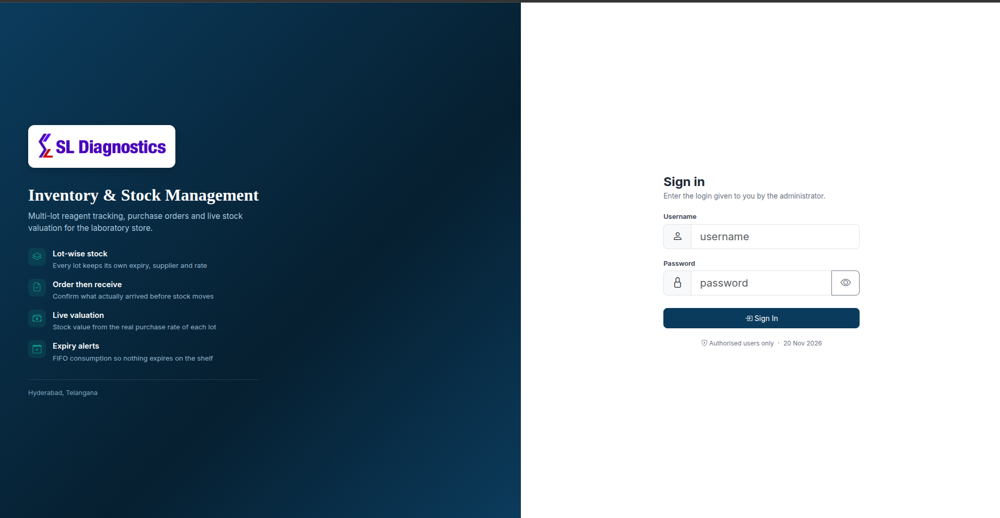
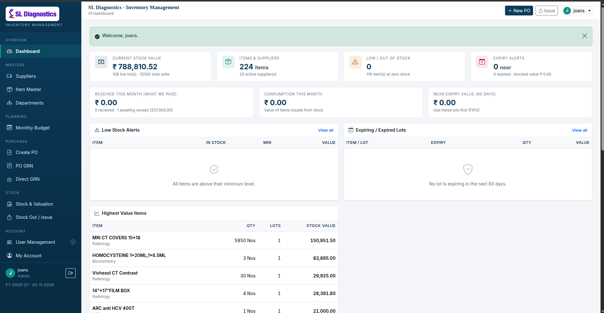

<div align="center">

<!-- ══════════ ANIMATED TYPING BANNER ══════════ -->
<a href="https://www.smartjoans.space">
  
</a>

<p>
  <strong>Core PHP (PDO) + MySQL + Bootstrap 5 + vanilla JS.</strong><br/>
  No framework, no composer, no build step. Runs on XAMPP locally and on cPanel / LiteSpeed shared hosting as-is.
</p>

<!-- ══════════ TECH BADGES ══════════ -->
<p>
  
  
  
  
  
  
</p>

<!-- ══════════ CREATOR / SUPPORT BADGES ══════════ -->
<p>
  <a href="https://www.smartjoans.space" target="_blank">
    
  </a>
  <a href="https://services.smartjoans.space" target="_blank">
    
  </a>
  <a href="https://instagram.com/smart_joans" target="_blank">
    
  </a>
</p>

</div>

> **This build:** clean database, login with Admin / User roles, your logo on the printed PO, and the two-stage **Order → Receive (GRN)** purchase workflow.

> 🧾 **Two editions — read this before you install.** The files lying open in this folder are the **standard build: inventory tracking without GST**. If you need **GST**, download **`inventory_with_GST.zip`**, use the files inside it, point them at the **same database**, and import the **update SQL that comes inside the zip**. Step-by-step in **[3 · GST edition](#3-gst-edition--without-gst-vs-with-gst)**.

---

## ⚡ Quick start

```bash
# 1 · copy the folder into htdocs (XAMPP) or public_html (cPanel)
# 2 · create the database
mysql -u root -p < database.sql

# 3 · edit the four constants at the top of db.php
# 4 · open login.php  →  admin / admin123  →  change the password immediately

# GST needed?  →  unzip inventory_with_GST.zip, use those files,
#                 and import the update SQL inside it into the SAME database
```

```
Login → Suppliers → Item Master → Create PO (Draft)
      → goods arrive: Receive (GRN) → Finalize → Stock Out
```

---

## 🧭 What's inside

| | | |
| :--- | :--- | :--- |
| 📦 **Item &amp; supplier masters**<br/>Department, analyser, default supplier and item code per item. Lot tracking is a per-item switch. | 🔁 **Two-stage purchase**<br/>Ordering raises a Draft only. Stock is created after the delivery is checked in. | 💰 **Exact valuation**<br/>No average costing — each lot keeps the rate it was bought at. |
| 🚚 **Direct GRN**<br/>Goods received with no purchase order, posted to stock in one screen. | 📤 **Issue vouchers**<br/>One slip, many items, FIFO or a lot you pick. All-or-nothing saving. | 📊 **Monthly budget**<br/>Opening → purchase → issues → closing → requirement, with draft POs in one click. |
| 🔐 **Locked down**<br/>bcrypt, CSRF, prepared statements, server-side guards, lockout. | 🖨️ **Print &amp; export**<br/>A4 PO with your logo, issue slips, CSV from stock report and budget. | 🕘 **Full audit trail**<br/>Who created, finalized and issued — names survive login deletion. |

---

## 📑 Contents

| | | | |
| :--- | :--- | :--- | :--- |
| [1 · Folder structure](#1-folder-structure) | [2 · Installation](#2-installation) | [3 · GST edition](#3-gst-edition--without-gst-vs-with-gst) | [4 · Document numbers](#4-three-documents-three-number-series) |
| [5 · Roles &amp; security](#5-roles--security) | [6 · Stock logic](#6-how-the-stock-logic-works) | [7 · Budget page](#7-the-budget-page) | [8 · Your logo](#8-your-logo) |
| [9 · Notes](#9-notes) | [10 · Troubleshooting](#10-troubleshooting) | [11 · Help &amp; support](#11-help--support) | |

---

## 1. Folder structure

```text
sl-inventory/
├── database.sql              Clean MySQL schema + ONE default admin login
├── upgrade_v3.sql            ONLY for an older install with data to keep
├── upgrade_v4.sql            ONLY for an older install: dept / equipment / budget
├── upgrade_v5.sql            ONLY for an older install: issue voucher columns
├── upgrade_v6.sql            ONLY for an older install: direct GRN flag
├── inventory_with_GST.zip    OPTIONAL — the SAME system WITH GST (files + its own update SQL)
├── logo.png                  ← PUT YOUR LOGO HERE (see section 8)
├── db.php                    App constants, session settings, PDO (EDIT THIS)
├── login.php                 Sign in (split-panel on desktop, single column on mobile)
├── logout.php                Sign out
├── index.php                 Dashboard — stock value, low stock, expiry, POs to receive
├── suppliers.php             Supplier master (CRUD)
├── items.php                 Item master (CRUD): lot switch, dept, analyser, supplier
├── departments.php           Departments + the equipment / analysers inside them
├── budget.php                Monthly budget — the sheet, inside the system
├── create_po.php             Raise / edit a Draft PO (AJAX rate auto-fill)
├── receive_po.php            Receive (GRN) — qty, rate, lot numbers, then finalize
├── direct_grn.php            Direct GRN — goods received with no purchase order
├── po_list.php               PO register — ordered vs received, variance
├── view_po.php               PO view + A4 print with logo + goods-received comparison
├── stock_report.php          Stock & valuation (lot-wise / item-wise) + CSV export
├── stock_out.php             Issue voucher — many items per slip + issue register
├── users.php                 User Management  ← ADMIN ONLY
├── profile.php               My Account — own name + own password (both roles)
├── includes/
│   ├── functions.php         Helpers + ALL stock business logic
│   ├── auth.php              Login session, roles, page guards
│   ├── header.php            <head>, sidebar, topbar  (set $page_title, $active)
│   └── footer.php            Closing markup + scripts
├── ajax/
│   ├── get_last_rate.php     ?item_id=&supplier_id= → last purchase rate + item info
│   └── get_batches.php       ?item_id= → available lots in FIFO order
├── assets/
│   ├── css/style.css         Theme, login page, responsive sidebar, print stylesheet
│   └── js/app.js             Shared JS (number formatting, fetch wrapper, confirms)

```

---

## 2. Installation

### Step 1 — Copy the folder
Copy `sl-inventory` into `htdocs` (XAMPP) or `public_html` (cPanel).

### Step 2 — Create and import the database

First, create a new database with your preferred name (for example, `sl_inventory`) and import `database.sql` into it, followed by `upgrade_v6.sql` to apply the latest schema updates.

**Option A — Using phpMyAdmin:**
1. Open **phpMyAdmin** and click **New** in the left sidebar to create a new database with your chosen name (using `utf8mb4_unicode_ci` collation).
2. Select your newly created database, go to the **Import** tab, choose `database.sql`, and click **Import**.
3. Once completed, stay inside the same database, return to the **Import** tab, choose `upgrade_v6.sql`, and click **Import**.

**Option B — From the shell:**
Replace `your_database_name` with the database name you want to create:
```bash
mysql -u root -p -e "CREATE DATABASE your_database_name CHARACTER SET utf8mb4 COLLATE utf8mb4_unicode_ci;"
mysql -u root -p your_database_name < database.sql
mysql -u root -p your_database_name < upgrade_v6.sql
```

This creates all eleven tables, the `v_item_stock` view, the v6 schema updates, and **one** row: the default administrator. No suppliers, no items, no stock — you build the masters from the app.

---

### Step 3 — Configure database & customize branding (`/db.php`)

After importing the database, open `/db.php` in your editor and update your database connection credentials (`DB_HOST`, `DB_NAME`, `DB_USER`, `DB_PASS`) to match the database you created in Step 2.

You can also customize the application name, company brand, address, GSTIN, and logo to match your organization by editing these constants inside `/db.php`:

```php
define('APP_NAME',    'Diagnostics - Inventory Management');
define('APP_BRAND',   'Diagnostics');
define('APP_TAGLINE', 'Inventory Management');
define('APP_ADDRESS', 'Hyderabad, Telangana');  // printed on the PO header
define('APP_GST',     '');                      // own GSTIN, printed if filled
define('APP_ROOT',    __DIR__);
define('APP_LOGO',    'logo.png');              // replace logo.png in the root folder with your own logo
```

| Constant | Purpose |
| :--- | :--- |
| `APP_ADDRESS` / `APP_GST` | Printed on the purchase order |
| `SESSION_IDLE_MINUTES` | Idle timeout — default `240` |
| `LOGIN_MAX_ATTEMPTS` | Brute-force brake — default `5` |
| `LOGIN_LOCK_MINUTES` | Lockout duration — default `5` |
| `DOC_PREFIX` / `GRN_PREFIX` / `ISSUE_PREFIX` | The three document number series |
| `APP_LOGO` | Logo file name — default `logo.png` |

### Step 4 — Log in
Open `login.php`:

| Field | Default value |
| :--- | :--- |
| **Username** | `admin` |
| **Password** | `admin123` |

> ⚠️ **Change this immediately** — log in, open **My Account**, set a new password.
> Passwords are stored as bcrypt hashes, never in plain text.

### Step 5 — First-run order
```text
Login → Suppliers → Item Master → Create PO (saved as Draft)
      → when the goods arrive: Receive (GRN) → Finalize → Stock Out
```
The dashboard shows a **Getting Started** checklist until the masters have data, and lists every PO still waiting to be received.

<details>
<summary><strong>🛠️ Already running an older build? (click to expand upgrade instructions)</strong></summary>

<br/>

Run `upgrade_v3.sql`, `upgrade_v4.sql`, `upgrade_v5.sql` and `upgrade_v6.sql` **in that order** instead of re-importing. Together they add the receipt tables, the department / equipment layer, the budget table, the issue voucher columns and the direct GRN flag — while keeping your data.

```bash
mysql -u root -p sl_inventory < upgrade_v3.sql
mysql -u root -p sl_inventory < upgrade_v4.sql
mysql -u root -p sl_inventory < upgrade_v5.sql
mysql -u root -p sl_inventory < upgrade_v6.sql
```

*A fresh install needs none of them.*
</details>

---

## 3. GST edition — without GST vs with GST

The files sitting open in this folder are the **standard build — purchase, receipt and valuation without GST**. Rate × quantity, nothing else, which is what an in-house laboratory store usually wants.

The **same system with GST tracking** is shipped separately, zipped, so that one folder never mixes the two.

| | Standard — this folder | GST edition — `inventory_with_GST.zip` |
| :--- | :--- | :--- |
| Where the files are | already extracted in the application root | inside the zip |
| Purchase → receipt | rate × quantity | rate × quantity **with GST** |
| Database | `database.sql` + `upgrade_v6.sql` | the **same database**, plus the update SQL that comes inside the zip |
| Who it is for | internal store, no tax working needed | purchases that have to carry the tax breakup |

### How to move to the GST edition

1. **Download `inventory_with_GST.zip`** and extract it somewhere outside the application folder.
2. **Take a backup of your database first** — phpMyAdmin → your database → **Export** → Go. One minute, and it is the only way back.
3. **Copy the files out of the zip into the application folder**, replacing the standard files of the same name. Keep your own `db.php` values and your own `logo.png` — re-enter the four `DB_*` constants and the `APP_*` branding if the zip overwrites them.
4. **Import the update SQL from the zip into the SAME database** you created in section 2 — do **not** create a second database. phpMyAdmin → select that database → **Import** → choose the SQL file from the zip → **Import**. It brings the schema up to the GST build on top of what is already there, so the suppliers, items, purchase orders and stock you have already entered stay where they are.
5. **Fill `APP_GST` in `db.php`** with your own GSTIN so it prints on the purchase order header.
6. Open `login.php` again. The same logins and the same roles work — nothing else to configure.

> ⚠️ **Run one build, not both.** The GST pages expect the columns the update SQL adds, so import the SQL **before** opening them — otherwise the pages come back with an *Unknown column* error.

> 📌 Already running without GST and live? You lose nothing by moving. The update SQL is applied over the existing database, so the history, the lots and the valuation carry over and only the new purchases carry the tax working.

**Not sure which build you need, or want the GST edition installed and the data moved for you? → message me any time: [services.smartjoans.space](https://services.smartjoans.space)**

---

## 4. Three documents, three number series

All defined at the top of `db.php`, so renaming any of them is a one-line change that every page follows.

| Document | Number | What it is |
| :--- | :--- | :--- |
| **Purchase Order** (`DOC_PREFIX`) | `PO/2026-27/0001` | What we ordered. Always a Draft until the goods arrive. |
| **Goods Receive Note** (`GRN_PREFIX`) | `GRN/2026-27/0001` | Goods received **without** a purchase order — `direct_grn.php`. |
| **Issue Voucher** (`ISSUE_PREFIX`) | `ISS/2026-27/0001` | Stock issued to a department. |

> Receiving against a purchase order keeps that order's own `PO/…` number — the received copy of the order *is* its goods receive note, which is why the printed sheet is headed **“Purchase Order”** while it is a Draft and **“Goods Receive Note”** once it has been received.

---

## 5. Roles & security

| Page | Admin | User |
| :--- | :---: | :---: |
| Dashboard, Suppliers, Item Master, Departments | ✔ | ✔ |
| Monthly Budget, requirement, draft POs from it | ✔ | ✔ |
| Create PO, Purchase Orders, Final conversion, Print | ✔ | ✔ |
| Stock & Valuation, CSV export, Stock Out, Reverse | ✔ | ✔ |
| My Account (own name / password) | ✔ | ✔ |
| **User Management (create logins, set roles)** | ✔ | ✖ |

A User can use every page except `users.php`; only an Admin can create logins. The guard is server-side — `require_login()` on every page and `require_admin()` on `users.php` — so typing the URL directly does not get a User in; the menu item is hidden as well. The ajax endpoints answer `401` to a dead session instead of leaking data.

Admin can create, edit, deactivate and delete logins, reset any password, and switch a login between Admin and User.

### 🛡️ Guards that cannot be overridden from the UI
- You cannot delete or deactivate your own login.
- The **last active Admin** cannot be deleted, deactivated or demoted — so the system can never be locked out.

<details>
<summary><strong>🔐 Security measures in full (click to expand)</strong></summary>

<br/>

| Area | Measure |
| :--- | :--- |
| Passwords | bcrypt `password_hash()` — never plain text |
| Forms | CSRF token on every form |
| Queries | Prepared statements everywhere |
| Output | `h()` on all output |
| Cookie | `HttpOnly` + `SameSite=Lax` (`Secure` automatically over HTTPS) |
| Session | ID regenerated on login · idle timeout (`SESSION_IDLE_MINUTES`) |
| Brute force | 5-attempt lockout for 5 minutes |
| Redirects | Whitelist on the post-login redirect |
| Ajax | `401` to a dead session instead of data |

</details>

> **Audit trail** — every purchase order stores who created it and who finalized it; every stock-out line stores who issued it. These names show on the PO register, the PO view (also under *Prepared By* when printed) and the issue register, and survive the deletion of that login.

---

## 6. How the stock logic works

### PO workflow — order first, receive second

<div align="center">
  
</div>

A purchase order can **never** be finalized straight from the order screen. It is always saved as a Draft, and stock is created only after the delivery is physically checked in.

| Stage | Page | Effect |
| :--- | :--- | :--- |
| **1. Order** | `create_po.php` | Item, quantity, expected rate. Always saved as **Draft**. `item_batches` untouched, nothing in the valuation. Editable and deletable. No lot numbers asked for. |
| **2. Receive (GRN)** | `receive_po.php` | What actually arrived: correct the quantity, correct the rate if the supplier hiked it, enter lot numbers and expiry dates, split one ordered line across several lots. Can be **saved** without finalizing (part delivery) — the PO stays Draft. |
| **3. Finalize** | `receive_po.php` | `finalize_po()` posts the **confirmed receipt rows** into `item_batches`. The PO becomes read-only and can only be printed, now headed *Goods Receive Note*. |

### Multi-lot items
`items.has_lot = 1` means every purchase creates/updates a row in `item_batches` carrying its own `lot_number`, `expiry_date`, `supplier_id` and `unit_price`.
`has_lot = 0` items (gloves, tubes, stationery) are stored under the reserved lot `GENERAL` with a `NULL` expiry; the PO form hides those two fields automatically.

### Valuation — no average costing
Each lot keeps the rate it was bought at, so:
```text
Current Total Stock Value = SUM(item_batches.quantity_available * item_batches.unit_price)
```
is exact even when the same item was bought from three suppliers at three rates.

### Ordered vs received — stored separately, never overwritten

| Table | Holds |
| :--- | :--- |
| `po_items` + `purchase_orders.grand_total` | what we asked |
| `po_receipts` + `purchase_orders.received_total` | what they gave |

So a PO ordered at ₹1,000 and delivered 8 of 10 at a hiked rate of ₹110 keeps the ₹1,000 order on record and posts ₹880 of stock. The difference is shown on the PO register, on the PO view and on the printed sheet. **Stock is always valued at the rate actually received, never the rate ordered.**

### Goods that arrive without an order
`direct_grn.php` — an urgent supply, a free replacement, a sample, something bought over the counter. One screen: GRN number (its own `GRN/…` series), supplier, date, invoice number, then the items with their lot, expiry, quantity and rate. Saving posts the stock immediately — no draft, no separate receive step.

Behind the scenes a direct GRN is stored exactly like a received purchase order (`purchase_orders.is_direct = 1`) with the ordered lines mirroring what was received, so it shows no variance, and the stock report, the valuation, the last-rate lookup and the monthly budget all count it the same as any other receipt. The register tags it **Direct GRN** and can filter on it, and the printed sheet says the goods came in without a purchase order. Put the same item on two rows with different lot numbers to receive it in two lots.

### Splitting a line across lots
On the Receive screen each ordered line has an **Add another lot for this item** button. Ten kits delivered as 5 of lot `AS123` and 5 of lot `AR123` become two receipt rows and two separate stock lots, each with its own expiry and rate. The screen shows the received quantity and value against the ordered figures line by line, so a short delivery or a price change is visible before you commit.

### One door into stock
`finalize_po()` in `includes/functions.php` is the **only** place stock is created. It is transaction-wrapped and flips the status with `UPDATE … WHERE id = ? AND status = 'Draft'`, so a double-click or two users finalizing at once can never post the same quantity twice. Finalizing with no confirmed receipt rows is refused. A received line merges into an existing lot only when `item + supplier + lot + expiry + rate` all match; any difference opens a new lot row so valuation stays accurate. Each receipt row keeps `batch_id`, so every stock lot traces back to the exact PO line it came from.

### Rate auto-fill
Picking an item in the PO form calls `ajax/get_last_rate.php`, which looks for the last **received** rate for that item *and* supplier, then the last received rate from any supplier, then the opening-stock rate. The field remains fully editable; once you type in it, changing the supplier will not overwrite your value.

### Stock out — the issue voucher

<div align="center">
  
</div>

One voucher is one slip: a date, a department, a voucher number and the person who collected the goods, then as many items as needed underneath. The voucher number is auto-filled as `ISS/2026-27/0001` but stays editable so it can match the numbers in your register book. *Received by* is typed in by hand.

Each line is taken **FIFO** (earliest expiry first, lots without an expiry last, spanning as many lots as needed) or from **one lot you pick** from that item's live lot list. Every slice writes a `stock_out` row with the lot's own rate, so the consumption value is historically correct, and all the lines of a voucher share one `voucher_no`.

Saving is all-or-nothing: `issue_voucher()` wraps the whole slip in one transaction, so if the third item is short of stock, the first two are rolled back too and nothing is issued — you never get half a voucher. Short quantities are rejected in full, never partially.

After saving, the voucher prints as a slip with your logo, the lot numbers, the values and signature lines for *Issued By* and *Received By*. In the register each voucher is shown as a block, and can be reversed one line at a time or whole — the quantity goes back to the same lot.

---

## 7. The Budget page

`budget.php` is the monthly stock budget sheet, live. Pick a month and it shows, per item:

```text
Opening  ->  Purchase  ->  Issues  ->  Closing  ->  Required for next month
```

grouped **Dept / Equipment** or **Supplier wise**, with sub-totals per group and a grand total. The system works the figures out from its own data — purchases from the PO receipts, issues from the Stock Out register, and `closing = opening + purchase − issues`.

| Action | What it does |
| :--- | :--- |
| **Required qty** | Editable per item. *Fill suggested* writes `issues × cover − closing` into every blank row, where *cover* (default 2 months) is yours to set. The rate is editable too. |
| **Save Requirement** | Stores it against the month. |
| **Close month** | Freezes the figures so that month's closing becomes the next month's opening — what keeps the chain going, the same way one sheet tab feeds the next. |
| **Create Draft POs (supplier wise)** | Turns the saved requirement into one Draft purchase order per supplier, using each item's default supplier. Items with no supplier set are skipped and listed. Nothing enters stock until each PO is received and finalized. |
| **Export** | Gives the same table as CSV, so the monthly file can still be mailed as before. |

Departments and analysers are maintained in `departments.php`, and every Stock Out entry picks a department from that list — which is what makes the department-wise consumption in the budget accurate.

---

## 8. Your logo

Put `logo.png` in the application root, next to `db.php`. It is used automatically on:
- the printed purchase order header (left side, beside the address / GSTIN),
- the login page (on a white panel, so a dark or coloured logo still reads),
- the sidebar brand area,
- the browser tab icon.

| Spot | Max height |
| :--- | :---: |
| Printed purchase order | `64px` |
| Login page | `66px` |
| Sidebar | `46px` |

Nothing breaks if the file is missing — every spot falls back to the text wordmark **SL Diagnostics** in Times New Roman Bold. A wide logo that already contains the full name works best; the width scales automatically. Replacing the file is enough — the `?v=` on the URL is the file's own modified time, so the new logo appears immediately instead of a cached one. To use a different file name, change `APP_LOGO` in `db.php`.

---

## 9. Notes

- **CDN-free option** — Bootstrap 5.3 and Bootstrap Icons load from jsDelivr. To go offline, download `bootstrap.min.css`, `bootstrap.bundle.min.js` and the icons font into `assets/` and change the tags in `includes/header.php`, `includes/footer.php` and `login.php`.
- **Entering opening stock** — either raise one PO per supplier with the current rates and receive it with the real lot numbers (recommended: it keeps the audit trail), or insert the rows straight into `item_batches`. Rows entered without a real lot number can carry a placeholder lot such as `OPENING` and be corrected later:
  ```sql
  UPDATE item_batches
     SET lot_number = 'AS123', expiry_date = '2027-06-30'
   WHERE item_id = 12 AND lot_number = 'OPENING';
  ```
- Editing a Draft PO after a receipt has been saved against it clears that saved receipt, since the ordered lines it referred to are replaced.
- Deletions are protected by referential checks: a supplier with POs, an item used in a PO or still holding stock, and any Final PO cannot be deleted — deactivate instead.

<details>
<summary><strong>🧱 Columns beyond the original spec (click to expand)</strong></summary>

<br/>

| Table | Added |
| :--- | :--- |
| `suppliers` / `items` / `users` | `is_active` |
| `purchase_orders` | `created_by`, `finalized_by`, `finalized_at`, `received_total`, `receive_date`, `invoice_no`, `receive_notes`, `is_direct` |
| `item_batches` | `po_id` (PO → lot traceability) |
| `stock_out` | `issued_by` |
| New tables | `users`, `po_receipts`, `stock_out` |
| New view | `v_item_stock` |

`po_items.lot_number` / `expiry_date` remain in the schema but are no longer filled by the order screen — lot details live in `po_receipts`.

</details>

---

## 10. Troubleshooting

<details open>
<summary><strong>Common issues and what they mean</strong></summary>

<br/>

| Symptom | Cause / fix |
| :--- | :--- |
| Blank white page after upload | `pdo_mysql` not enabled, or a PHP error is hidden. Enable the extension and check the server error log. |
| `SQLSTATE[HY000] [1045] Access denied` | `DB_USER` / `DB_PASS` in `db.php` do not match the cPanel database user. |
| `Unknown database 'sl_inventory'` | `database.sql` was not imported, or cPanel prefixed the name — put the real name in `DB_NAME`. |
| Logged out too often | Raise `SESSION_IDLE_MINUTES` in `db.php` (default 240). |
| Locked out after wrong passwords | Wait `LOGIN_LOCK_MINUTES` (default 5), or clear the attempt rows in the database. |
| New logo not showing | Hard-refresh once; the `?v=` is the file's modified time, so re-save the file if needed. |
| PO will not finalize | No confirmed receipt rows yet — save the receipt on the GRN screen first. |
| Cannot delete a supplier / item | It is referenced by a PO or still holds stock. Deactivate instead. |
| Issue voucher refuses to save | A line is short of stock; the whole slip rolls back. Check that item's available lots. |
| Stock value looks wrong | Check the lot rates in the stock report — valuation uses the **received** rate per lot, not the ordered rate. |
| GST pages error with *Unknown column* | The update SQL inside `inventory_with_GST.zip` was never imported, or it went into a different database. Import it into the **same** database and reload. |
| GST fields missing after replacing the files | You copied the GST files but skipped the zip's update SQL — see section 3. |

</details>

---
## Screenshots

<details name="screenshots" open>
  <summary><b>1. Login Page</b></summary>
  <br>
  
</details>

<details name="screenshots">
  <summary><b>2. Dashboard</b></summary>
  <br>
  
</details>

<details name="screenshots">
  <summary><b>3. Item Master</b></summary>
  <br>
  
</details>

<details name="screenshots">
  <summary><b>4. Supplier Master</b></summary>
  <br>
  
</details>

<details name="screenshots">
  <summary><b>5. Department & Equipment Master</b></summary>
  <br>
  
</details>

<details name="screenshots">
  <summary><b>6. Create Purchase Order (PO)</b></summary>
  <br>
  
</details>

<details name="screenshots">
  <summary><b>7. PO Receiving</b></summary>
  <br>
  
</details>

<details name="screenshots">
  <summary><b>8. Direct GRN Received</b></summary>
  <br>
  
</details>

<details name="screenshots">
  <summary><b>9. Stock Out Issue</b></summary>
  <br>
  
</details>

<details name="screenshots">
  <summary><b>10. Stock Valuation</b></summary>
  <br>
  
</details>

<details name="screenshots">
  <summary><b>11. Stock Valuation (Detailed)</b></summary>
  <br>
  
</details>

<details name="screenshots">
  <summary><b>12. Monthly Budget Planning</b></summary>
  <br>
  
</details>

<details name="screenshots">
  <summary><b>13. User Management</b></summary>
  <br>
  
</details>

<details name="screenshots">
  <summary><b>14. User Profile</b></summary>
  <br>
  
</details>

## 11. Help & support

<div align="center">

### Designed &amp; developed by **SmartJOANS**

Full-stack web development — PHP / MySQL systems, ASP.NET, Node.js services and digital tools.

**Need a hand with the installation, the GST edition, moving your existing data, or any customisation? Contact me any time — I am happy to help.**

<a href="https://services.smartjoans.space" target="_blank">
  
</a>

| Platform | Link |
| :--- | :--- |
| 🛠️ **Support &amp; Services** | **[services.smartjoans.space](https://services.smartjoans.space)** |
| 📸 **Instagram** | **[@smart_joans](https://instagram.com/smart_joans)** |
| 🌐 **Website** | [www.smartjoans.space](https://www.smartjoans.space) |
| 📚 **SmartLib** | [books.smartjoans.space](https://books.smartjoans.space) |
| 🔗 **Sharable** | [sharable.smartjoans.space](https://sharable.smartjoans.space) |
| 💳 **Digital CV** | [myprofile.cc](https://myprofile.cc) |

**Also built:** [artintentions.in](https://artintentions.in) · [writerpraba.co.in](https://writerpraba.co.in)

<br/>

<!-- ══════════ ANIMATED WAVING FOOTER ══════════ -->


**Diagnostics — Laboratory Inventory &amp; Stock Management System**
*Core PHP · MySQL · Bootstrap 5 · No build step*
**Built by SmartJOANS · [services.smartjoans.space](https://services.smartjoans.space) · [@smart_joans](https://instagram.com/smart_joans)**

</div>
