<div align="center">



<br>

**Core PHP (PDO) + MySQL + Bootstrap 5 + vanilla JS**
No framework · no composer · no build step · runs on XAMPP and cPanel / LiteSpeed as-is

`PHP 7.4+ (tested on 8.3)` • `pdo_mysql` • `11 tables + 1 view` • `Admin / User roles`

</div>


## Contents

| | |
|---|---|
| [1 · Folder structure](#1--folder-structure) | What ships in the folder |
| [2 · Installation](#2--installation) | Copy → import → edit `db.php` → log in |
| [3 · Document numbers](#3--three-documents-three-number-series) | PO / GRN / ISS series |
| [4 · Roles & security](#4--roles--security) | Who can do what, and how it is guarded |
| [5 · Stock logic](#5--how-the-stock-logic-works) | Lots, valuation, the PO workflow, FIFO |
| [6 · Budget page](#6--the-budget-page) | The monthly sheet, live |
| [7 · Your logo](#7--your-logo) | Where `logo.png` appears |
| [8 · Notes](#8--notes) | Small things that save time later |
| [9 · Help & contact](#9--help--contact) | Support, customisation, a build of your own |


## 1 · Folder structure

```
sl-inventory/
├── database.sql              Clean MySQL schema + ONE default admin login
├── upgrade_v3.sql            ONLY for an older install with data to keep
├── upgrade_v4.sql            ONLY for an older install: dept / equipment / budget
├── upgrade_v5.sql            ONLY for an older install: issue voucher columns
├── upgrade_v6.sql            ONLY for an older install: direct GRN flag
├── logo.png                  ← PUT YOUR LOGO HERE (see section 7)
├── db.php                    App constants, session settings, PDO (EDIT THIS)
├── login.php                 Sign in (split-panel on desktop, single column on mobile)
├── logout.php                Sign out
├── index.php                 Dashboard — stock value, low stock, expiry, POs to receive
├── suppliers.php             Supplier master (CRUD)
├── items.php                 Item master (CRUD): lot switch, dept, analyser, supplier
├── departments.php           Departments + the equipment / analysers inside them
├── budget.php                Monthly budget — the sheet, inside the system
├── create_po.php             Raise / edit a Draft PO (AJAX rate auto-fill)
├── receive_po.php            Receive (GRN) — qty, rate, lot numbers, then finalize
├── direct_grn.php            Direct GRN — goods received with no purchase order
├── po_list.php               PO register — ordered vs received, variance
├── view_po.php               PO view + A4 print with logo + goods-received comparison
├── stock_report.php          Stock & valuation (lot-wise / item-wise) + CSV export
├── stock_out.php             Issue voucher — many items per slip + issue register
├── users.php                 User Management  ← ADMIN ONLY
├── profile.php               My Account — own name + own password (both roles)
├── includes/
│   ├── functions.php         Helpers + ALL stock business logic
│   ├── auth.php              Login session, roles, page guards
│   ├── header.php            <head>, sidebar, topbar  (set $page_title, $active)
│   └── footer.php            Closing markup + scripts
├── ajax/
│   ├── get_last_rate.php     ?item_id=&supplier_id= → last purchase rate + item info
│   └── get_batches.php       ?item_id= → available lots in FIFO order
├── assets/
│   ├── css/style.css         Theme, login page, responsive sidebar, print stylesheet
│   └── js/app.js             Shared JS (number formatting, fetch wrapper, confirms)
└── docs/                     Images used by this README
```


## 2 · Installation

**Step 1 — Drop the folder in place**
Copy `sl-inventory` into `htdocs` (XAMPP) or `public_html` (cPanel). No composer, no build step.

**Step 2 — Import the database**

```bash
# phpMyAdmin → Import, or from the shell:
mysql -u root -p < database.sql
```

It creates `sl_inventory`, all eleven tables, the `v_item_stock` view and **one** row: the default
administrator. No suppliers, no items, no stock — you build the masters from inside the app.

**Step 3 — Edit the top of `db.php`**

```php
define('DB_HOST', 'localhost');
define('DB_NAME', 'sl_inventory');
define('DB_USER', 'root');      // cPanel: your DB user
define('DB_PASS', '');          // cPanel: your DB password
```

| Constant | Purpose |
|---|---|
| `APP_ADDRESS` / `APP_GST` | Printed on the purchase order |
| `SESSION_IDLE_MINUTES` | Idle timeout — default **240** |
| `LOGIN_MAX_ATTEMPTS` | Brute-force brake — default **5** |
| `LOGIN_LOCK_MINUTES` | Lockout duration — default **5** |
| `DOC_PREFIX` / `GRN_PREFIX` / `ISSUE_PREFIX` | The three document number series |
| `APP_LOGO` | Logo file name — default `logo.png` |

**Step 4 — Log in**

| | |
|---|---|
| Username | `admin` |
| Password | `admin123` |

> ⚠️ **Change this immediately** — log in, open **My Account**, set a new password.
> Passwords are stored as bcrypt hashes, never in plain text.

**Step 5 — First-run order**

```
Login → Suppliers → Item Master → Create PO (saved as Draft)
      → when the goods arrive: Receive (GRN) → Finalize → Stock Out
```

The dashboard shows a **Getting Started** checklist until the masters have data, and lists every PO
still waiting to be received.

> 💡 **Already running an older build?** Run `upgrade_v3.sql`, `upgrade_v4.sql`, `upgrade_v5.sql` and
> `upgrade_v6.sql` **in that order** instead of re-importing — together they add the receipt tables,
> the department / equipment layer, the budget table, the issue voucher columns and the direct GRN
> flag while keeping your data. A fresh install needs none of them.


## 3 · Three documents, three number series

All defined at the top of `db.php`, so renaming any of them is a one-line change that every page follows.

| Document | Number | What it is |
|---|---|---|
| **Purchase Order** (`DOC_PREFIX`) | `PO/2026-27/0001` | What we ordered. Always a Draft until the goods arrive. |
| **Goods Receive Note** (`GRN_PREFIX`) | `GRN/2026-27/0001` | Goods received **without** a purchase order — `direct_grn.php`. |
| **Issue Voucher** (`ISSUE_PREFIX`) | `ISS/2026-27/0001` | Stock issued to a department. |

Receiving against a purchase order keeps that order's own `PO/…` number — the received copy of the
order *is* its goods receive note, which is why the printed sheet is headed **“Purchase Order”** while
it is a Draft and **“Goods Receive Note”** once it has been received.


## 4 · Roles & security

| Page | Admin | User |
|---|:---:|:---:|
| Dashboard, Suppliers, Item Master, Departments | ✔ | ✔ |
| Monthly Budget, requirement, draft POs from it | ✔ | ✔ |
| Create PO, Purchase Orders, Final conversion, Print | ✔ | ✔ |
| Stock & Valuation, CSV export, Stock Out, Reverse | ✔ | ✔ |
| My Account (own name / password) | ✔ | ✔ |
| **User Management (create logins, set roles)** | ✔ | ✖ |

A User can use every page except `users.php`; only an Admin can create logins. The guard is
**server-side** — `require_login()` on every page and `require_admin()` on `users.php` — so typing the
URL directly does not get a User in; the menu item is hidden as well. The ajax endpoints answer `401`
to a dead session instead of leaking data.

**Guards that cannot be overridden from the UI**

- You cannot delete or deactivate your own login.
- The **last active Admin** cannot be deleted, deactivated or demoted — so the system can never be locked out.

**Security**

`bcrypt password_hash` · CSRF token on every form · prepared statements everywhere · `h()` on all
output · HttpOnly + SameSite=Lax session cookie (Secure automatically over HTTPS) · session ID
regenerated on login · idle timeout · 5-attempt lockout · whitelist on the post-login redirect.

**Audit trail** — every purchase order stores who created it and who finalized it; every stock-out line
stores who issued it. These names show on the PO register, the PO view (also under *Prepared By* when
printed) and the issue register, and survive the deletion of that login.


## 5 · How the stock logic works

### The purchase workflow

<div align="center">


</div>

A purchase order can **never** be finalized straight from the order screen. It is always saved as a
Draft, and stock is created only after the delivery is physically checked in.

| Stage | Page | Effect |
|---|---|---|
| **1. Order** | `create_po.php` | Item, quantity, expected rate. Always saved as **Draft**. `item_batches` untouched, nothing in the valuation. Editable and deletable. No lot numbers asked for. |
| **2. Receive (GRN)** | `receive_po.php` | What actually arrived: correct the quantity, correct the rate if the supplier hiked it, enter lot numbers and expiry dates, split one ordered line across several lots. Can be **saved** without finalizing (part delivery) — the PO stays Draft. |
| **3. Finalize** | `receive_po.php` | `finalize_po()` posts the **confirmed receipt rows** into `item_batches`. The PO becomes read-only and can only be printed, now headed Goods Receive Note. |

### Multi-lot items

`items.has_lot = 1` means every purchase creates/updates a row in `item_batches` carrying its own
`lot_number`, `expiry_date`, `supplier_id` and `unit_price`.

`has_lot = 0` items (gloves, tubes, stationery) are stored under the reserved lot `GENERAL` with a NULL
expiry; the PO form hides those two fields automatically.

### Valuation — no average costing

Each lot keeps the rate it was bought at, so

```
Current Total Stock Value = SUM(item_batches.quantity_available * item_batches.unit_price)
```

is exact even when the same item was bought from three suppliers at three rates.

### Ordered vs received — stored separately, never overwritten

| Table | Holds |
|---|---|
| `po_items` + `purchase_orders.grand_total` | what we asked |
| `po_receipts` + `purchase_orders.received_total` | what they gave |

So a PO ordered at ₹1,000 and delivered 8 of 10 at a hiked rate of ₹110 keeps the ₹1,000 order on
record and posts ₹880 of stock. The difference is shown on the PO register, on the PO view and on the
printed sheet. **Stock is always valued at the rate actually received, never the rate ordered.**

### Goods that arrive without an order

`direct_grn.php` — an urgent supply, a free replacement, a sample, something bought over the counter.
One screen: GRN number (its own `GRN/…` series), supplier, date, invoice number, then the items with
their lot, expiry, quantity and rate. Saving posts the stock immediately — no draft, no separate
receive step.

Behind the scenes a direct GRN is stored exactly like a received purchase order
(`purchase_orders.is_direct = 1`) with the ordered lines mirroring what was received, so it shows no
variance, and the stock report, the valuation, the last-rate lookup and the monthly budget all count it
the same as any other receipt. The register tags it **Direct GRN** and can filter on it, and the
printed sheet says the goods came in without a purchase order. Put the same item on two rows with
different lot numbers to receive it in two lots.

### Splitting a line across lots

On the Receive screen each ordered line has an *Add another lot for this item* button. Ten kits
delivered as 5 of lot `AS123` and 5 of lot `AR123` become two receipt rows and two separate stock lots,
each with its own expiry and rate. The screen shows the received quantity and value against the ordered
figures line by line, so a short delivery or a price change is visible before you commit.

### One door into stock

`finalize_po()` in `includes/functions.php` is the **only** place stock is created. It is
transaction-wrapped and flips the status with `UPDATE … WHERE id = ? AND status = 'Draft'`, so a
double-click or two users finalizing at once can never post the same quantity twice. Finalizing with no
confirmed receipt rows is refused. A received line merges into an existing lot only when
item + supplier + lot + expiry + rate all match; any difference opens a new lot row so valuation stays
accurate. Each receipt row keeps `batch_id`, so every stock lot traces back to the exact PO line it came
from.

### Rate auto-fill

Picking an item in the PO form calls `ajax/get_last_rate.php`, which looks for the last **received**
rate for that item *and* supplier, then the last received rate from any supplier, then the opening-stock
rate. The field remains fully editable; once you type in it, changing the supplier will not overwrite
your value.

### Stock out — the issue voucher

<div align="center">



</div>

One voucher is one slip: a date, a department, a voucher number and the person who collected the goods,
then as many items as needed underneath. The voucher number is auto-filled as `ISS/2026-27/0001` but
stays editable so it can match the numbers in your register book. *Received by* is typed in by hand.

Each line is taken **FIFO** (earliest expiry first, lots without an expiry last, spanning as many lots
as needed) or from **one lot you pick** from that item's live lot list. Every slice writes a `stock_out`
row with the lot's own rate, so the consumption value is historically correct, and all the lines of a
voucher share one `voucher_no`.

Saving is **all-or-nothing**: `issue_voucher()` wraps the whole slip in one transaction, so if the third
item is short of stock, the first two are rolled back too and nothing is issued — you never get half a
voucher. Short quantities are rejected in full, never partially.

After saving, the voucher prints as a slip with your logo, the lot numbers, the values and signature
lines for *Issued By* and *Received By*. In the register each voucher is shown as a block, and can be
reversed one line at a time or whole — the quantity goes back to the same lot.


## 6 · The Budget page

`budget.php` is the monthly stock budget sheet, live. Pick a month and it shows, per item:

```
Opening  ->  Purchase  ->  Issues  ->  Closing  ->  Required for next month
```

grouped **Dept / Equipment** or **Supplier wise**, with sub-totals per group and a grand total. The
system works the figures out from its own data — purchases from the PO receipts, issues from the Stock
Out register, and `closing = opening + purchase − issues`.

- **Required qty** is editable per item. *Fill suggested* writes `issues × cover − closing` into every
  blank row, where *cover* (default 2 months) is yours to set. The rate is editable too.
- **Save Requirement** stores it against the month.
- **Close month** freezes the figures so that month's closing becomes the next month's opening. That is
  what keeps the chain going, the same way one sheet tab feeds the next.
- **Create Draft POs (supplier wise)** turns the saved requirement into one Draft purchase order per
  supplier, using each item's default supplier — a supplier-wise budget raised as actual POs in one
  click. Items with no supplier set are skipped and listed. Nothing enters stock until each PO is
  received and finalized.
- **Export** gives the same table as CSV, so the monthly file can still be mailed as before.

Departments and analysers are maintained in `departments.php`, and every Stock Out entry picks a
department from that list — which is what makes the department-wise consumption in the budget accurate.


## 7 · Your logo

Put `logo.png` in the application root, next to `db.php`. It is used automatically on:

- the **printed purchase order** header (left side, beside the address / GSTIN),
- the **login page** (on a white panel, so a dark or coloured logo still reads),
- the **sidebar** brand area,
- the **browser tab** icon.

Nothing breaks if the file is missing — every spot falls back to the text wordmark **SL Diagnostics** in
Times New Roman Bold. A wide logo that already contains the full name works best: it is capped at 64px
tall on the PO, 66px on login and 46px in the sidebar, and the width scales automatically. Replacing the
file is enough — the `?v=` on the URL is the file's own modified time, so the new logo appears
immediately instead of a cached one. To use a different file name, change `APP_LOGO` in `db.php`.


## 8 · Notes

- **CDN-free option** — Bootstrap 5.3 and Bootstrap Icons load from jsDelivr. To run fully offline,
  download `bootstrap.min.css`, `bootstrap.bundle.min.js` and the icons font into `assets/` and change
  the tags in `includes/header.php`, `includes/footer.php` and `login.php`.
- **Entering opening stock** — either raise one PO per supplier with the current rates and receive it
  with the real lot numbers (recommended: it keeps the audit trail), or insert the rows straight into
  `item_batches`. Rows entered without a real lot number can carry a placeholder lot such as `OPENING`
  and be corrected later:
  ```sql
  UPDATE item_batches
     SET lot_number = 'AS123', expiry_date = '2027-06-30'
   WHERE item_id = 12 AND lot_number = 'OPENING';
  ```
- **Editing a Draft PO** after a receipt has been saved against it clears that saved receipt, since the
  ordered lines it referred to are replaced.
- **Deletions are protected** by referential checks: a supplier with POs, an item used in a PO or still
  holding stock, and any Final PO cannot be deleted — deactivate instead.
- **Columns beyond the original spec** — `is_active` on `suppliers` / `items` / `users`; `created_by`,
  `finalized_by`, `finalized_at`, `received_total`, `receive_date`, `invoice_no`, `receive_notes` on
  `purchase_orders`; `po_id` on `item_batches` (PO → lot traceability); `issued_by` on `stock_out`; plus
  the `users`, `po_receipts` and `stock_out` tables and the `v_item_stock` view.
  `po_items.lot_number` / `expiry_date` remain in the schema but are no longer filled by the order
  screen — lot details live in `po_receipts`.


## 9 · Help & contact

<div align="center">

### Designed &amp; developed by **SmartJOANS**

Full-stack web development — PHP / MySQL systems, ASP.NET, Node.js services and digital tools.

| | |
|---|---|
| 🛠️ **Support &amp; Services** | **[services.smartjoans.space](https://services.smartjoans.space)** |
| 📸 **Instagram** | **[@smart_joans](https://www.instagram.com/smart_joans)** |
| 🌐 Main site | [www.smartjoans.space](https://www.smartjoans.space) |
| 📚 SmartLib | [books.smartjoans.space](https://books.smartjoans.space) |
| 🔗 Sharable | [sharable.smartjoans.space](https://sharable.smartjoans.space) |
| 💳 Digital CV | [myprofile.cc](https://myprofile.cc) |

Installation help, customisation, a new module, a bug, or a build of your own —
reach out at **[services.smartjoans.space](https://services.smartjoans.space)**.

Also built: [artintentions.in](https://artintentions.in) · [writerpraba.co.in](https://writerpraba.co.in)

<br>


**SL Diagnostics** — Laboratory Inventory &amp; Stock Management System
Core PHP · MySQL · Bootstrap 5 · No build step

Built by [SmartJOANS](https://www.smartjoans.space) · [@smart_joans](https://www.instagram.com/smart_joans)

</div>
